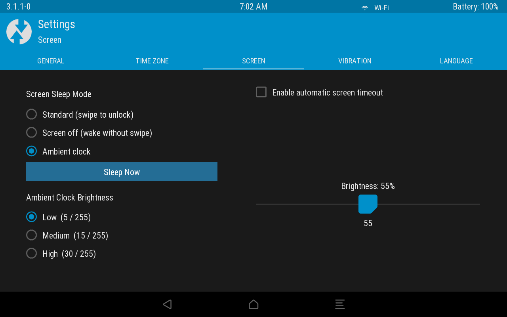
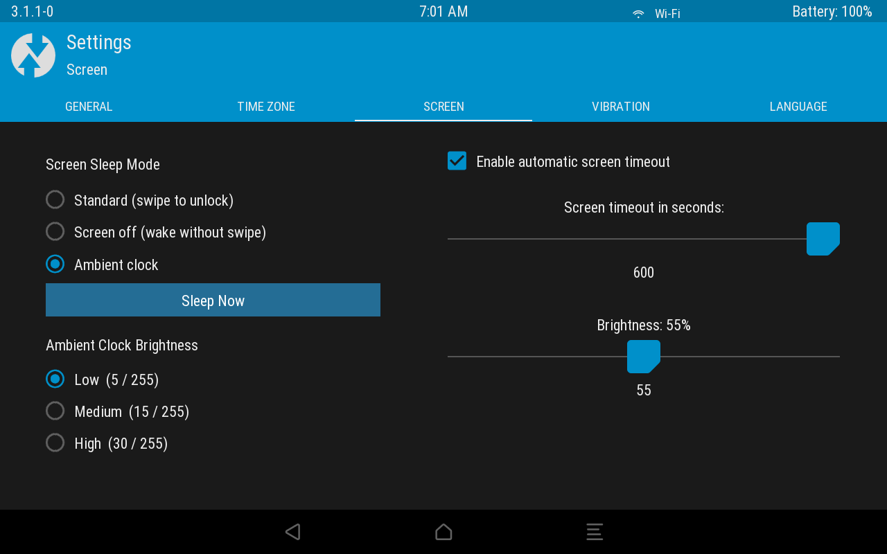

# Xoom TWRP — Screen Settings design preview (October 21, 2026)

These are **unaltered 1280 × 800 screenshots captured from the actual Motorola Xoom running the v6T recovery GUI**, using an inert, RAM-only theme preview of the proposed Screen Sleep Settings layout. They are **not** screenshots of a finished functional Screen Sleep implementation.

## Latest state: automatic TWRP screen timeout disabled

[Open full-resolution screenshot](settings-screen-v3-radio-two-column-timeout-disabled.png)

The native **Enable automatic screen timeout** checkbox was turned **off** through the tablet's GUI at the user's request before capturing this image. Consequently the timeout slider is hidden by TWRP's normal conditional behavior.

## Comparison: timeout enabled, showing 600-second slider

[Open full-resolution screenshot](settings-screen-v3-radio-two-column-timeout-enabled.png)

The slider's proposed maximum is **600 seconds (10 minutes)**. The existing normal-brightness slider remains on the right below it.

## Design notes

The left column shows two independent, mutually exclusive choice groups using radio-style indicators: **Standard (swipe)**, **Screen Off**, or **Ambient Clock**; and **Low 5/255**, **Medium 15/255**, or **High 30/255** ambient backlight brightness. **Sleep Now** is separate. All seven newly proposed controls are deliberately **inert in this preview**, and the highlighted choices represent illustrative defaults, not active modes. The normal TWRP timeout and brightness controls remain functional.

The new controls are intended for a future separately tested and explicitly authorized native recovery image. No recovery image was flashed for these screenshots. The v6T native executable was unchanged.

SHA256 image checks:
- Timeout disabled: 2f6468ec5b6107d8e772aa4b799f1cab2404af1e75472709c5d53d0bb2e1c8f9
- Timeout enabled: 93aae745c62570c14fad7dc86431778361b24c424f3ebac9444ab004ea434e63
- RAM XML theme SHA256: dfcc3696946701c5646ff1fe6d3370c2af7a4d54e65bad816c906aabfffd932b
